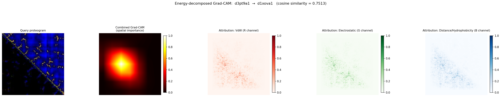
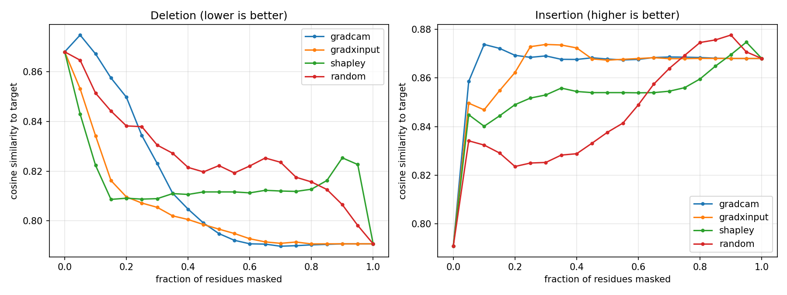

# Energy-Decomposed Grad-CAM

> The tools described here are independent of the training loss and work on
> any trained Proteogram model, including a plain CrossEntropy-only model.

## What This Document Covers

This document describes **Energy-Decomposed Grad-CAM**: an explainability
tool that reveals *which physical force* (Van der Waals, electrostatic, or
geometric distance) drove a similarity prediction between two proteins,
rather than only *where* in the image the model focused.

---

## Background: How Proteogram Works (No Domain Knowledge Required)

### The core idea

A protein is a chain of amino acids folded into a 3D shape. Whether two proteins have similar shapes matters enormously in biology — similar shapes often mean similar functions, and finding similar proteins helps understand disease mechanisms and design drugs.

Traditional tools compare protein shapes by literally trying to superimpose one structure on top of another (like fitting puzzle pieces together). Proteogram takes a completely different approach: it converts each protein into a **picture**, then uses image-recognition AI to find similar pictures.

### What the picture encodes

A proteogram is a square heatmap image. If a protein has N amino acids, the image is N×N pixels. Each pixel at position (row i, column j) encodes the **interaction between amino acid i and amino acid j** — how strongly they attract, repel, or are spaced apart.

The image has 3 colour channels (like any RGB photo), each encoding a different type of physical interaction:

| Channel | Colour | What it measures |
|---------|--------|-----------------|
| Channel 0 | Red (R) | Van der Waals (VdW) energy — the short-range "stickiness" between atoms when they are very close |
| Channel 1 | Green (G) | Electrostatic energy — attraction/repulsion between electrically charged amino acids |
| Channel 2 | Blue (B) | Geometric distance between amino acids / hydrophobicity similarity |

**Van der Waals forces** are what holds the hydrophobic core of a protein together — the oil-like interior that squeezes away from water. **Electrostatic forces** govern interactions between charged residues on the protein surface. **Geometric distance** is the raw spatial separation between amino acid pairs.

### How the AI model learns

A convolutional neural network (CNN) looks at thousands of these proteogram images and learns to produce a compact numerical "fingerprint" (embedding) for each protein. Two proteins with similar fingerprints are predicted to be structurally similar. The cosine similarity between two fingerprints — a number between -1 and 1 — is the similarity score.

---

## Background: What is Grad-CAM?

**Grad-CAM** (Gradient-weighted Class Activation Mapping) is an explanation technique for neural networks. When a model makes a prediction, Grad-CAM asks: "which part of the input image most influenced this prediction?" It does this by flowing the prediction signal backwards through the network and measuring which image regions caused the strongest gradients.

In the original Proteogram Grad-CAM implementation (already present before this work), the output is a single heatmap showing *where* in the proteogram image the model focused — which residue pairs drove the similarity score.

## The New Contribution: Channel Decomposition

The original heatmap answers **WHERE** the model focused. The new decomposed Grad-CAM answers **WHICH FORCE** drove the focus.

Instead of computing one combined heatmap over all three channels, we compute three separate attribution maps — one per input channel — using **baseline-corrected Gradient × Input** saliency:

```
attribution_k(i, j) = | ∂(cosine_sim) / ∂(input[k, i, j])  ×  (input[k, i, j] − baseline_k) |
```

In plain English: for each residue pair (i, j) and each physical channel k, this measures "how much would the cosine similarity change if I slightly changed the VdW / electrostatic / distance value at this position?"

The multiplication by the input value is important — it weights the gradient by the magnitude of the signal. A large gradient at a pixel carrying no energy doesn't matter; a large gradient at a pixel with strong VdW energy matters a lot.

**Why the baseline term.** "No signal" in a proteogram is the neutral sentinel 128 (used both as the pad fill and, via `normalisation.ZERO_FILL_VALUE`, for structural zeros) — not 0. After ImageNet normalisation, 128 maps to a *different* value in each channel (+0.074 R, +0.205 G, +0.426 B — a ~6× spread), so multiplying by the raw normalised input gives each channel a different attribution floor purely from preprocessing constants, and makes padding and structural-zero regions accrue attribution they should not have. Subtracting `baseline_k` makes the multiplier `(pixel − 128) / std_k`; the three `std` values differ by under 2%, so the channels become directly comparable and genuinely empty regions score exactly zero.

### Output

The tool produces a **5-panel figure** per protein pair:

1. Original query proteogram (the input image)
2. Combined Grad-CAM heatmap (WHERE — existing capability)
3. VdW attribution map (Red channel — new)
4. Electrostatic attribution map (Green channel — new)
5. Distance/hydrophobicity attribution map (Blue channel — new)

### The key derived metric: Energy/Distance ratio

From the three channel attributions, we compute:

```
Energy/Distance ratio = (mean VdW attribution + mean Electrostatic attribution) / mean Distance attribution
```

This ratio measures how much the model relies on **physical energy terms** (VdW + electrostatic) relative to **pure geometry** (distance) when assessing similarity.

> **Correction — the no-preference baseline is 2.0, not 1.0.** An earlier
> version of this document stated that "a ratio of 1.0 means equal reliance."
> That is wrong: the numerator aggregates *two* channels and the denominator
> *one*, so a model with no channel preference whatsoever scores **2.0**. A
> ratio of 1.77 is therefore *below* no-preference — relatively
> distance-leaning — rather than evidence of energy dominance. Any
> interpretation of the older E/D figures that read them against 1.0 has the
> direction of the effect backwards.

**The ratio must be computed on unnormalised attributions.** `compute_decomposed()` returns two arrays: `attr_display`, in which each channel is independently min-max scaled to [0, 1] so every panel of the figure uses its full colourmap, and `attr_raw`, the unnormalised magnitudes. Every statistic here compares magnitudes *across* channels, which is only meaningful when the channels share a scale — on a per-channel-rescaled array all three channels span [0, 1] by construction and the ratio degenerates into a comparison of distribution shape rather than of reliance on each force. `Img2Vec.gradcam_decomposed_similarity()` therefore returns `attr_raw`, and `channel_dominance_stats()` warns if it is handed an array bearing the min-max signature.

### Files changed

| File | What changed |
|------|-------------|
| `proteogram/v2/gradcam.py` | Added `compute_decomposed()`, `compute_decomposed_from_paths()`, `save_decomposed_figure()`, `save_decomposed_npy()` methods to the `GradCAM` class. Channel labels and colourmap constants added. Fixed `tight_layout` warning by switching to `layout="constrained"`. |
| `proteogram/v2/image_similarity.py` | Added `gradcam_decomposed_similarity()` wrapper method to `Img2Vec`, making decomposed Grad-CAM accessible from the main API. |
| `scripts/v2/explain_energy_channels.py` | **New script.** Handles pair selection (manual via TSV or automatic via USalign categories), runs decomposed Grad-CAM on all pairs, saves figures, computes and saves channel attribution statistics CSV. |
| `scripts/v2/validate_attribution_faithfulness.py` | **New script.** Deletion / insertion curves testing whether the attribution maps actually track what the model relies on, versus a random-ordering control. |
| `proteogram/v2/masking.py` | **New module.** Shared neutral-value (128) masking of residues, pixels and channels, used by Shapley and the faithfulness curves. |
| `proteogram/v2/shapley.py` | **New module.** Exact channel-level and permutation-sampled residue-level Shapley values. |
| `tests/test_attribution.py` | **New tests.** Masking semantics, Shapley axioms (efficiency, symmetry, null player, convergence), and the Grad × Input baseline giving zero on neutral pixels. No trained model needed. |

### How to run

```bash
# From scripts/v2/
uv run python explain_energy_channels.py \
    --model_file /path/to/trained_model.pt \
    --proteograms_dir /path/to/proteograms/eval \
    --auto \
    --usalign_results /path/to/usalign_out.tsv \
    --annotations_tsv /path/to/ProteogramData_SCOP_RCSB_PDBe_AnnotationsLookup_AllSCOPe208.tsv \
    --output_dir /path/to/energy_explanations
```

`--model_file` accepts any trained Proteogram model — this tool has no
dependency on how the model was trained (CrossEntropy-only, triplet, or
otherwise).

The `--auto` flag selects three categories of protein pairs automatically:
- `same_fold_high_sim`: same SCOP fold, TM-score ≥ 0.7 (true positives — the model should get these right)
- `same_fold_low_sim`: same fold, TM-score ≤ 0.4 (hard cases — same fold but dissimilar)
- `diff_fold_low_sim`: different fold, TM-score ≤ 0.3 (true negatives — clearly unrelated)

---

## Channel-Level Shapley Values (the axiomatic replacement for E/D)

The E/D ratio, even computed correctly on raw attributions, is a heuristic:
nothing guarantees that a ratio of mean `|grad × input|` measures "reliance."
`proteogram/v2/shapley.py` provides a grounded alternative that treats the
three channels as three players in a cooperative game.

With only 3 players, Shapley values are computed **exactly** from all 8
coalitions — 8 forward passes per pair, no sampling. The payoff of a coalition
is the cosine similarity when only those channels retain their real values and
the rest are masked to the neutral sentinel. This satisfies **efficiency**:

```
phi_ch0 + phi_ch1 + phi_ch2  ==  cos(query, target) − cos(neutral, target)
```

So each channel's number is a share of a genuinely measurable quantity, and
"VdW accounts for 42% of this pair's similarity" becomes a falsifiable claim
rather than a unit-free index. The computation reports
`efficiency_residual` as a built-in self-check — it must be ~0.

It runs by default in `explain_energy_channels.py` alongside the gradient-based
E/D ratio, so the two can be compared on identical pairs (`--no_shapley` to
skip). Report `energy_share_vs_null`, which is already expressed relative to
the 2/3 no-preference baseline, rather than the raw share.

## Validating That the Attributions Are Faithful

A heatmap that looks convincing is not evidence that the model relies on what
it highlights. `scripts/v2/validate_attribution_faithfulness.py` tests that
property directly with deletion / insertion curves (Petsiuk et al., RISE,
2018), comparing both attribution methods against a random-ordering control:

- **Deletion** — progressively replace the highest-attributed regions of the
  query with the neutral sentinel, re-embed, re-measure cosine similarity. A
  faithful map makes similarity collapse quickly, so **lower AUC is better**.
- **Insertion** — start from an all-neutral image and restore the
  highest-attributed regions first. **Higher AUC is better.**

```bash
# From scripts/v2/
uv run python validate_attribution_faithfulness.py \
    --model_file /path/to/trained_model.pt \
    --proteograms_dir /path/to/proteograms/eval \
    --auto \
    --usalign_results /path/to/usalign_out.tsv \
    --annotations_tsv /path/to/annotations.tsv \
    --output_dir /path/to/faithfulness
```

`--granularity residue` (the default) masks whole residues — row *i* plus
column *i* — which matches how a proteogram encodes structure and is the fair
setting when comparing against the coarse Grad-CAM map; `pixel` masks
individual residue pairs.

**How to read it:** an attribution method whose faithfulness gap does not
clearly beat `random` is not explaining the model, whatever its heatmaps look
like. Run this before quoting any attribution-derived result, including the
E/D ratio.

## Sample Results

A sample run of all three tools on the current code (commit `16b910f` plus
the pair-selection fix). These numbers show what the tools produce and how to
read them. The samples are small, so treat them as a sanity check, not a
benchmark.

**Setup.**
- Model: `proteogram_model_resnet18_lr0.001_bs8_e53_seed0_max_image_size300_input200_resize_min_class_size20_level-superfamily_lossce_acc93.9.pt`,
  a plain CrossEntropy ResNet18 (superfamily level, 93.9% accuracy).
- Proteograms: the SCOPe 2.08 eval set.
- Pairs: chosen with `--auto` from the USalign results for the `queries-scope20840` set.
- Pairs per category: `--top_k_auto 20` for `explain_energy_channels.py` (60 pairs in total) and
  `--top_k_auto 10` for `validate_attribution_faithfulness.py` (30 pairs, 19
  distinct queries, `--granularity residue`, 3 Shapley permutations).
- Hardware: a single RTX 4060 Ti. Each run takes a few minutes.

A later run on the coarse-grained `lj_fix` proteograms, with checkpoint-matched
preprocessing, a method comparison and a conclusion, is in
[`docs/results/attribution_lj_fix/`](results/attribution_lj_fix/README.md).

The per-pair outputs are in
[`docs/results/attribution/`](results/attribution/):
- `channel_attribution_stats.csv` has one row per pair.
- `faithfulness_summary.csv` has one row per method.

### Example figure



The pair is `d3pt9a1` (167 residues) against `d1xova1`, from the
`same_fold_low_sim` category: same SCOP fold, low TM-score, cosine similarity
0.751.
- The combined Grad-CAM panel is coarse. It covers 7×7 cells, so read it as a region, not as individual residue pairs.
- The three Grad × Input panels resolve individual residue pairs. All three
  concentrate along the diagonal band of short-range contacts.
- The channel Shapley values for this pair are φ = (−0.025, +0.033, +0.051)
  for VdW, electrostatics and distance. They sum to the explained 0.059.
- So the distance channel carries most of this pair's similarity, and the
  energy share is 13% against a no-preference baseline of 67%. The Grad × Input
  panels alone do not show this, because each panel is rescaled to its own
  maximum.

### Channel attribution (20 pairs per category)

The table reports means across pairs (± standard deviation where shown).

| Category | cos(query, target) | cos(neutral, target) | Explained Δ | Gradient E/D ratio | Shapley energy share vs. 2/3 null | Pairs above null |
|---|---|---|---|---|---|---|
| diff_fold_low_sim | 0.778 | 0.728 | 0.050 | 4.04 ± 0.27 | −0.3 pts (median −0.2) | 50% |
| same_fold_low_sim | 0.838 | 0.758 | 0.079 | 4.23 ± 0.48 | −6.0 ± 17.0 pts | 25% |
| same_fold_high_sim | 0.963 | 0.818 | 0.145 | 4.56 ± 0.33 | +5.4 ± 9.5 pts | 75% |

What the table shows:

- **The Shapley computation is exact.** Across all 60 pairs the largest
  |Σφ − explained Δ| is 2.8e-17.
- **The gradient E/D ratio is a poor guide.**
  - It sits at about 4 in every category and moves only a little (4.0 → 4.6).
  - Grad × Input names electrostatics as the dominant channel in all 60 pairs.
  - Shapley shows that the energy channels carry about their proportional share, not twice it.
  - Report the Shapley numbers. Keep the gradient ratio only as a heuristic to compare against.
- **Energy share follows structural similarity, but only weakly.**
  - For high-TM same-fold pairs, the energy channels carry slightly more than their share (72% of the explained similarity, against a 67% null).
  - For low-TM same-fold pairs they carry less (61%).
  - Both effects are smaller than the spread between pairs, so neither is established at n = 20.
- **The model's similarity has a high floor.** An all-neutral query already
  scores 0.73–0.82 against the target, so the input explains only 0.05–0.15 of
  cosine similarity. In `diff_fold_low_sim` the explained Δ is close to 0 for
  some pairs. That makes the share unstable: its standard deviation is 146 pts,
  so use the median for that row.
- **The sample is narrow.**
  - `--auto` takes the extreme pairs, so a few queries dominate each category. For example, `d3ryce1` is the query in 11 of the 20 `diff_fold_low_sim` pairs.
  - The `same_fold_high_sim` queries are short, with a median of 38 residues.
  - Before quoting any trend, sample pairs across the full TM-score range.

### Faithfulness (30 pairs, residue granularity)



| Method | Deletion AUC ↓ | Insertion AUC ↑ | Gap ↑ | Pairs where gap beats random |
|---|---|---|---|---|
| Grad-CAM | 0.813 | 0.866 | 0.053 | 83% |
| Grad × Input | **0.804** | 0.864 | **0.060** | **87%** |
| Residue Shapley (3 perms) | 0.816 | 0.854 | 0.038 | 80% |
| Random | 0.826 | 0.845 | 0.019 | — |

- **Every method beats the random ordering, and Grad × Input does best.** Its
  advantage over random is 0.041 ± 0.008 (standard error over 30 pairs).
- **The advantage comes almost entirely from `same_fold_high_sim`.** There the
  Grad × Input gap is 0.117, against 0.032 for random. In `diff_fold_low_sim`
  every method is close to random (0.017 against 0.009), which is expected
  when the input explains so little.
- **Residue Shapley with 3 permutations is too noisy** to beat the gradient
  methods here. Raise `--shapley_permutations` before using it as the
  reference.

## Recommended Next Steps

1. **Sample beyond the extremes.** `--auto` takes the top-k pairs at each end of the TM-score range, so a few queries dominate each category (see the caveats above). Draw pairs at random within each band, with one pair per query, and use 50+ pairs per category.
2. **Report variance, not just the mean**, per category. The per-pair CSV (`channel_attribution_stats.csv`) has what you need to compute a std or CI for each category, so don't rely on the printed mean alone.
3. **Pick one case study pair** from `same_fold_high_sim` where VdW dominates and look up the known biology — if it is a membrane protein or a tightly-packed beta-barrel, the VdW dominance is physically expected and provides a compelling narrative example.

---

## Novelty Assessment — ML Research Perspective

### Explainability / XAI

The energy-decomposed attribution uses **Gradient × Input** saliency — one of the simplest gradient-based attribution methods (Baehrens et al. 2010, Simonyan et al. 2013). It is less theoretically rigorous than Integrated Gradients (Sundararajan et al. 2017) or SHAP, but has the advantage of requiring a single backward pass.

**What is new**: The input channels have a physically meaningful, predefined semantics (VdW / electrostatic / distance). Most Grad-CAM applications produce a single spatial heatmap over an undifferentiated RGB image. Here, the three channels are not arbitrary colour channels — they are **physical force channels** — so the per-channel attribution has a direct scientific interpretation that is absent in natural image settings.

The Energy/Distance ratio — `(mean(A_VdW) + mean(A_electrostatic)) / mean(A_distance)` — is a domain-specific aggregation of this attribution, similar in spirit to **feature group importance** (grouping correlated features and measuring their collective effect) but derived from spatial gradient attribution rather than permutation importance.

### Novelty rating and positioning

| Dimension | Rating | Justification |
|-----------|--------|---------------|
| **Method novelty** | Low-moderate | Gradient × Input is a well-established, simple saliency method; the channel decomposition itself is a straightforward per-channel application of it |
| **Application novelty** | Moderate | Attributing similarity predictions to physically named channels (VdW/electrostatic/distance) rather than arbitrary RGB channels gives the output a direct scientific reading not present in typical Grad-CAM use |
| **Engineering contribution** | Moderate | Clean, reusable implementation (`compute_decomposed`, `gradcam_decomposed_similarity`, `explain_energy_channels.py`) that works with any trained model |

### Current limitations in ML terms

| Limitation | Impact | Mitigation |
|------------|--------|-----------|
| **The combined Grad-CAM panel cannot resolve residue pairs** | ResNet18's last conv layer is **7×7** for a 200×200 proteogram, bilinearly upsampled to 200×200 — each cell covers ~29×29 pixels ≈ **816 residue pairs**. Per-residue-pair claims are only supportable from the Grad × Input panels, which are genuinely per-pixel; the two appear side by side in the same figure at different effective granularities | Read the combined panel as regional, not per-pair; use the decomposed panels for residue-pair claims |
| 5 pairs per category by default in E/D ratio computation | Underpowered; high variance; not publishable as is | Increase to ≥ 20 pairs or use all available pairs |
| Gradient × Input vs Integrated Gradients | The baseline correction fixes the channel-offset bias, but G×I still does not satisfy the completeness axiom and can miss saturation effects | Run IG as ablation (it reuses the same 128 baseline); expect a similar E/D trend |
| Attribution is computed w.r.t. the query only | The target is detached, so `explain(A,B) ≠ explain(B,A)` even though `cos(A,B)` is symmetric — half the evidence is structurally invisible | Report both directions, or average them |
| Grad-CAM applies ReLU to the CAM | Regions that *decreased* similarity are dropped, so "why is this not a match" is unanswerable | Inspect signed CAMs if negative evidence matters |
| Channel↔force mapping is triangle-dependent | Because the proteogram stacks two maps per channel (upper vs. rotated lower triangle), channel 0 is VdW-attractive in the upper triangle and ES-attractive in the lower — "channel 0 = VdW" is only half true | Split statistics by triangle before attributing to a named force |
| No variance/significance reporting in the script's console summary | A single mean per category can look like a clean trend even when driven by 1-2 outlier pairs | Compute per-category std/CI from `channel_attribution_stats.csv` before quoting a ratio |
