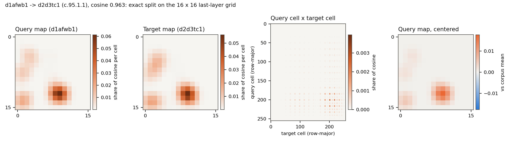
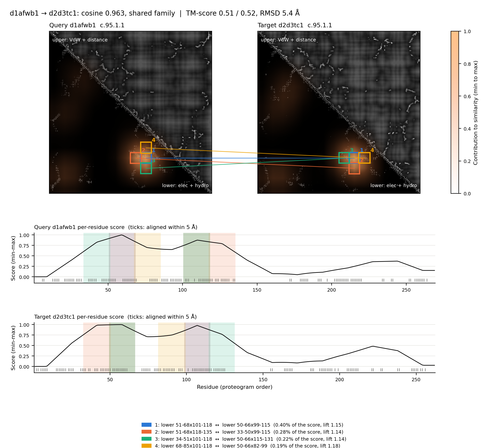
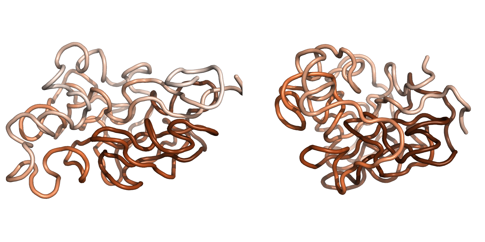
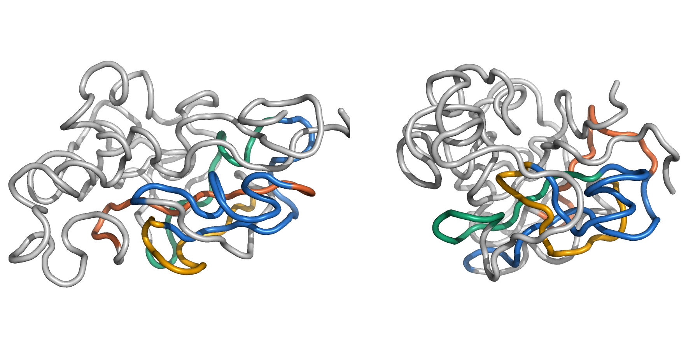
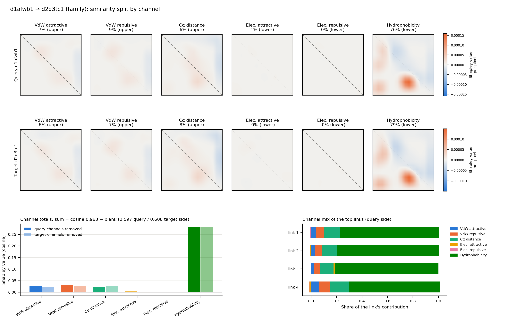

# Explaining Proteogram Similarity

*Applies to `scripts/v2/explain_batch.sh`, `select_explain_pairs.py`, `explain_similarity_maps.py` and `proteogram.v2.similarity_maps` / `proteogram.v2.usalign`.*

For a query and a hit, this pipeline shows **which regions of the two proteograms, and so which residues, made the model call them similar**. It then checks those regions against a structural alignment from USalign.

## How it works

Search embeds a proteogram as the average of ResNet18's last feature map (a 16 x 16 grid of cells for a 500 x 500 input). Because the embedding is an average, the cosine similarity splits **exactly** over pairs of cells:

    cos(q, t) = sum_a sum_b F_q(a) . F_t(b) / (256^2 |q| |t|)

where:

- **F_q(a)** is the 512-number feature vector that ResNet18's last convolutional block (`layer4`) outputs at cell *a* of the query's 16 x 16 grid: one value per feature channel, all >= 0 (they follow a ReLU). Cell *a* is centred on one 32 x 32-pixel block of the 500 x 500 input, so on one block of residue pairs.
- **F_t(b)** is the same for cell *b* of the target.
- **q** and **t** are the search embeddings: the averages of F_q(a) over the query's 256 cells and of F_t(b) over the target's, i.e. q = (1/256) sum_a F_q(a). |q| and |t| are their lengths.
- **F_q(a) . F_t(b)** is the dot product of the two 512-number vectors: how strongly query cell *a* and target cell *b* respond to the same features.

Each term F_q(a) . F_t(b) / (256^2 |q| |t|) is the contribution of the pair (query cell *a*, target cell *b*). There are 256 x 256 such terms, and the query-cell x target-cell matrix they form sums to the search score, with no gradients and no approximation. From it come:

- a **query map** and a **target map** (row and column sums of the matrix, each summing to the cosine);
- **links**: the top cell pairs, read as "this query region matched that target region";
- **centered maps** (optional): the same, minus what every protein shares with the corpus mean embedding. Use these to see what is specific to the pair.



*The split for one pair (run 3 model, both c.95.1.1, cosine 0.963), shown as fractions of the cosine on the 16 x 16 grid. The query and target maps each sum to 1. The cell x cell matrix (256 x 256, cells numbered row by row) sums to 1. Its dotted look comes from the row-by-row numbering: neighbouring rows of the grid are 16 entries apart. The centered map has the corpus-average part removed; here the same lower-right block remains, so that region is specific to this pair rather than shared by most proteins.*

The maps are upsampled to the native L x L proteogram and summed per residue. The proteogram's lower triangle is stored rotated 180 degrees: lower pixel (p, q) is residue pair (L-1-p, L-1-q), and the code handles this. The halves hold different channels:

| Half | Channels |
|---|---|
| Upper | VdW attractive, VdW repulsive, C-alpha distance |
| Lower | Electrostatic attractive, electrostatic repulsive, hydrophobicity |

**Resolution.** One cell covers about L/16 residues per axis (about 10 for a 150-residue domain, 25 for 400). The maps locate segments, not single residues. A cell is centred on its block but sees beyond it, which is why the faithfulness test below exists.

## Running it

Requirements: the trained ResNet18 checkpoint and its `evaluate_methods_v2.py` run, the proteogram images, USalign (`USalign` on `PATH` or `~/Documents/bin/USalign/USalign`), and optionally PyMOL. PyMOL is run as a program (`pymol -cq`), so it is not a Python dependency.

Use the machine that has the SCOPe `.ent` structures. Without them the script falls back to the CG production structures, and about 14% of those do not match their proteogram's residue count. Those structures are skipped, not guessed.

From `scripts/v2`:

```bash
bash explain_batch.sh                       # run 3 model, all strata
MAX_PAIRS=6 bash explain_batch.sh           # smoke test
FAITHFULNESS=0 bash explain_batch.sh        # ~3x faster, no deletion/insertion test
CHANNELS=0 bash explain_batch.sh            # skip the per-channel split
MODEL=.../proteogram_model_..._seed1_....pt \
  EVAL_DIR=.../eval_runs/eval_20261126-002519_superfamily_k10 TAG=run36 bash explain_batch.sh
```

`explain_batch.sh` runs two steps:

1. **`select_explain_pairs.py`** re-embeds the eval corpus with the model and rebuilds each query's full ranked list. It checks the top 10 against the eval run (`ranked_check.txt`; expect about 99% overlap) and samples pairs by stratum. It is skipped if `pairs.tsv` already exists; set `FORCE_SELECT=1` to redo it.
2. **`explain_similarity_maps.py`** explains every pair.

**Strata.** A *stratum* is a group of pairs chosen by the same rule, such as "the query's first hit outside its own superfamily, when that hit is in the same fold". The pipeline samples pairs separately within each stratum (up to `N` each, default 100) instead of sampling from all pairs together. Two reasons: the groups behave differently (a same-family hit is close to a duplicate, while a remote fold hit is not), and a pooled sample would be dominated by the most common kind of pair. Results are therefore reported per stratum, and the `stratum` column in `summary.tsv` says which group each pair came from. The strata match the remote-homology metrics of `evaluate_methods_v2.py`:

| Stratum | Pair | Purpose |
|---|---|---|
| `family_top1` | top-1 hit, same family | reference: near-duplicate matches |
| `superfamily_remote` | first hit outside the query's family, same superfamily | remote homology |
| `fold_remote` | first hit outside the query's superfamily, same fold | Proteogram's strength. Every case all three aligners miss comes first (`aligners_miss_fold`) |
| `fold_remote_miss` | first hit outside the superfamily, different fold | control: confident errors |
| `novel_superfamily` | top-1 hit of a query whose superfamily was not in training | generalisation |

For a few hand-picked pairs, call the explainer directly:

```bash
python explain_similarity_maps.py --model_file MODEL.pt --pair d1afwb1 d2d3tc1 --faithfulness
```

## Outputs

Each batch writes `evaluation/explain_runs/pairs_<TAG>/` and `evaluation/explain_runs/explain_<TAG>_<time>/`. The second holds:

| File | Contents |
|---|---|
| `summary.tsv` | One row per pair: cosine, alignment, every check below, stratum |
| `report.txt` | Console log, with means by stratum, SCOPe relation, TM-score bin and aligner outcome |
| `pairs/<q>__<t>/figure.png` | Both proteograms with their maps and numbered links, plus per-residue profiles (ticks = residues USalign aligns within 5 A) |
| `pairs/<q>__<t>/links.tsv` | Top links: residue segments on each side, share of the score, lift |
| `pairs/<q>__<t>/residues_*.tsv` | Per-residue score (upper / lower half), alignment partner |
| `pairs/<q>__<t>/query.pdb`, `target.pdb` | Scores in the B-factor column; the query is superposed onto the target |
| `pairs/<q>__<t>/view_scores.pml`, `view_links.pml` | Open in PyMOL (`pymol view_scores.pml`); PNG renders are saved when PyMOL is found |
| `pairs/<q>__<t>/channels.png` | With `--channels`: the six channel maps per protein, channel totals, and each link's channel mix ([below](#channel-breakdown---channels)) |
| `pairs/<q>__<t>/maps.npz` | Raw cell matrix and maps (and per-channel cell maps with `--channels`) |

Link labels read `lower 51-68x101-118`: the lower-triangle pixels for residue segments 51-68 against 101-118. These are electrostatic and hydrophobic interactions between those segments. Residue numbers follow proteogram order (1..L). `residues_*.tsv` gives the original PDB numbering in `resid`.

### Example: `figure.png`



- **Top row.** Each proteogram is shown in gray with its map in orange (scaled min to max). The dashed line is the diagonal, upper half above it, lower half below. Numbered boxes are the top links: the same number and colour on both sides, joined by a line, is one query region matched to one target region.
- **Profiles.** Per-residue scores for the query and target. Shaded bands are the residues each link covers; ticks along the bottom mark residues USalign aligns within 5 A.
- **Legend.** Each link with its residue segments, its share of the score and its lift.

Here nearly all of the score sits in the lower triangle (electrostatics and hydrophobicity) and in the first ~135 residues of both proteins. Link 1 joins query 51-68 x 101-118 to target 50-66 x 99-115, essentially the same segments in both proteins, and the profiles peak where the alignment ticks are dense.

### Example: PyMOL renders



*`pymol_scores.png`: query (left, superposed onto the target by USalign) and target (right), coloured by per-residue score from light (low) to dark orange (high). Each protein is scaled to its own maximum.*



*`pymol_links.png`: the residues of each link, in the link colours from the figure; link 1 (blue) is drawn on top where links overlap. These renders used the CG production structures (C-alpha only), so they show tubes; with the crystal `.ent` files PyMOL draws secondary structure.*

## Channel breakdown (`--channels`)

The exact split above says *where* the similarity comes from, but not *which channel*: the network's first layer mixes R, G and B, so by the last layer the channels are no longer separate. `--channels` (on by default in `explain_batch.sh`; `CHANNELS=0` to skip) separates them by removing channels from the input and re-running the model.

**How.** The six channels (three per half) are treated as six players:

| Channel | Half | Image channel |
|---|---|---|
| VdW attractive | upper | R |
| VdW repulsive | upper | G |
| C-alpha distance | upper | B |
| Electrostatic attractive | lower | R |
| Electrostatic repulsive | lower | G |
| Hydrophobicity | lower | B |

For each of the 2^6 = 64 combinations of channels, the missing channels are blanked in one protein's native proteogram (set to 0, the "no interaction" value; `--channel_fill gray` uses 128), and the exact cell x cell split is recomputed against the other, unchanged protein. The 64 splits are combined with Shapley weights. Each split is exact and Shapley values add linearly, so every cell pair (and so every region, link and residue) divides **exactly** into six channel values, which sum to the full split minus the split with that protein fully blanked. This is done twice, once removing the query's channels and once the target's: 128 extra forward passes per pair (a few seconds on a GPU, about 20 s on a laptop CPU).



*`channels.png` for the example pair. Top two rows: each channel's Shapley map on the query and on the target (orange raises the similarity, blue lowers it), with the channel's share of the explained similarity in the title. Bottom left: channel totals, which sum to the cosine (0.963) minus the cosine with that protein blanked (0.597 query side / 0.608 target side). Bottom right: the channel mix of each top link from the main figure.*

For this pair hydrophobicity carries 76% (query side) and 79% (target side) of the explained similarity, the VdW channels and C-alpha distance 6-9% each, and the electrostatic channels almost nothing. So the lower-triangle signal in the main figure is hydrophobicity, not electrostatics, and the top links are 72-81% hydrophobicity.

**Outputs.** `summary.tsv` gains `ch_<channel>_query` / `_target` (Shapley totals, in cosine units), `ch_share_<channel>_query` / `_target` (shares of the explained part), `cos_blank_query` / `_target` and `channel_split_error` (the 64-subset reconstruction against the main split, about 1e-9 from float32). `links.tsv` gains `ch_share_<channel>` per link, `residues_*.tsv` gains `ch_<channel>` per residue, and `maps.npz` stores the per-channel cell maps. `report.txt` lists the mean query-side shares by stratum.

**Reading it.**
- **Shares are of the explained part.** A blanked proteogram still scores about 0.6 against most targets, so the channels explain cosine minus that baseline. Shares compare channels within a pair; the totals (`ch_<channel>_*`) compare pairs.
- **Why a channel's map covers both triangles.** A channel map is not an image of that channel's pixels. For each last-layer cell, it shows how much that cell's contribution to the cosine changes when the channel is removed, averaged over every combination of the other five channels being present or absent. Each cell's features are computed from a wide region of the image, so blanking hydrophobicity (lower triangle) also changes the features, and so the contributions, of cells that sit over the upper triangle. The values are this channel's own effect, not the leftover contributions of the other channels; the other channels only set the context in which the removal is measured.
- **Why there are positive and negative values, and the scale.** Orange means the channel raises that cell's contribution; blue means the cell contributes *more* without it. Negative values come from the cosine's normalisation: adding a channel changes the length of the whole embedding, so a cell whose features do not grow with the rest gets a smaller share of the similarity. The maps are not normalised per channel: values are Shapley values in cosine units spread over each cell's pixels, and the colour scale is shared by a protein's six maps (symmetric around 0), so map intensities can be compared across channels. The percentages in the titles are each channel's share of the explained similarity.
- **Blanked images are unusual inputs.** The model never saw a proteogram with a channel missing, so the values describe how the trained model's score responds to removing a channel, not a physical energy decomposition. Exact Shapley handles interactions between channels correctly, but this caveat remains. Distance and hydrophobicity are features rather than forces, so "contribution by channel" is the accurate wording.
- **Shapley shares are not training ablations.** Retraining on one channel at a time measures what a channel can support *on its own*; the Shapley share measures what *this trained model* relies on. A channel can be informative alone yet get a small share because another channel carries the same information.

## Interpreting the checks

| Column | Question | Good sign |
|---|---|---|
| `decomposition_error` | Does the split reproduce the search score? | about 1e-16 (always) |
| `auroc_query`, `auroc_target` | Do high-scoring residues sit in the aligned core (pairs within 5 A)? | > 0.5 |
| `contact_enrichment_*`, `contact_p_*` | Share of map mass on contacts conserved under the alignment, against a null that shifts scores along each diagonal | enrichment > 1, p < 0.05 |
| `link_agree_contribution` vs `link_base_contribution` | Do the top links join regions that USalign also pairs, compared with linking to an average target cell? | agree well above base |
| `deletion_auc_exact` vs `deletion_auc_random` | Does removing the top-scoring cells lower the score faster than removing random cells? (see [Faithfulness](#faithfulness-deletion-and-insertion)) | exact below random for the same pair |
| `insertion_auc_exact` vs `insertion_auc_random` | Does restoring only the top cells rebuild the score faster than restoring random cells? | exact above random for the same pair |

### Faithfulness: deletion and insertion

A map is *faithful* if the regions it ranks highest are the regions the model actually depends on. A map can look plausible without being faithful, so this is tested directly by editing the query image and re-running the model (`--faithfulness`, on by default in `explain_batch.sh`):

- **Deletion.** Rank the query's 256 cells by the exact query map. Blank out the top 0%, 10%, 20%, ... 100% of cells (each cell's block of the input image is set to black, the proteogram's "no interaction" value; `--mask_fill gray` uses the pad value instead). Re-embed the edited query at each step and record its cosine to the unchanged target. If the map is faithful, the cosine falls quickly at first, because the most important regions go first.
- **Insertion.** The reverse: start from a blank image and restore the top cells first. If the map is faithful, the cosine climbs back quickly.
- **Random order.** Repeat both with the cells in random order (`--n_random`, default 5 orders, averaged). This is the reference.

Each curve is summarised by its **AUC**: the area under cosine-versus-fraction-of-cells, with the fraction running from 0 to 1. Since the x-axis has length 1, the AUC is simply the average cosine along the curve. A low deletion AUC means the score dropped early; a high insertion AUC means it recovered early.

**What "deletion below random" means.** Compare `deletion_auc_exact` with `deletion_auc_random` for the same pair; the map is doing better than chance when exact is lower. It is **not** a comparison with 0.5. The 0.5 reference applies to the AUROC columns, where 0.5 is chance, but these AUCs are average cosines. Their level depends on the pair: where the curve starts (the pair's own cosine) and where it ends (the cosine of a fully blanked image to the target, which is not 0). Only the gap between the map's order and the random order means something:

- deletion: exact 0.72 vs random 0.82 → removing the top cells costs the score faster than chance (gap 0.10);
- insertion: exact 0.91 vs random 0.81 → the top cells alone rebuild most of the score;
- exact ≈ random → the map's ranking carries no more information than chance about what the model uses.

Across a batch, report the share of pairs where exact beats random and the mean gap, per stratum. The test masks whole cells (about L/16 residues on each side), so it checks the maps at the resolution they are drawn at, not single residues. Only the query is edited; the target stays fixed.

For the example pair above (one pair, so an illustration only):

| Check | d1afwb1 -> d2d3tc1 |
|---|---|
| Cosine / TM-score | 0.963 / 0.51 |
| Residue AUROC (query / target) | 0.66 / 0.64 |
| Conserved-contact enrichment (query) | 2.0x, p = 0.001 (the smallest possible with 1,000 shuffles) |
| Link agreement vs baseline | 0.47 vs 0.13 |
| Deletion AUC, exact vs random | 0.72 vs 0.82 |
| Insertion AUC, exact vs random | 0.91 vs 0.81 |

Every check points the same way: the top-scoring regions sit in the aligned core, the links join regions the alignment pairs, and the score depends on those regions.

**Caveats.**
- **Read the structural checks by TM-score.** For pairs with TM-score >= 0.5 the alignment is a trustworthy reference. For remote pairs (often < 0.5, including most `fold_remote` aligner-miss cases) the alignment is itself weak. Low agreement there is ambiguous, not a failure of the map.
- **Maps share a common part.** Feature values are non-negative, so a region that is strong in general scores well against most partners. Compare with the centered maps and the `fold_remote_miss` control before calling a region pair-specific.
- **Lift is the weaker link ranking.** Ranking links by lift (match beyond each cell's overall strength) agreed with the alignment less than ranking by contribution in early runs. Contribution is the default.
- **The maps explain the model's score, not biology directly.** They say what the network used; the structural checks say how often that coincides with the shared structural core.

**Picking case studies.** Start from `fold_remote` rows with `aligners_miss_fold = True` where the map is faithful (`deletion_auc_exact` clearly below `deletion_auc_random` for that pair). Then compare TM-score with the links: a low TM-score with links that join corresponding segments is the strongest example of Proteogram seeing a shared fold that alignment-based scores miss.
