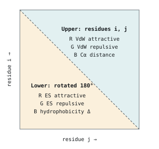
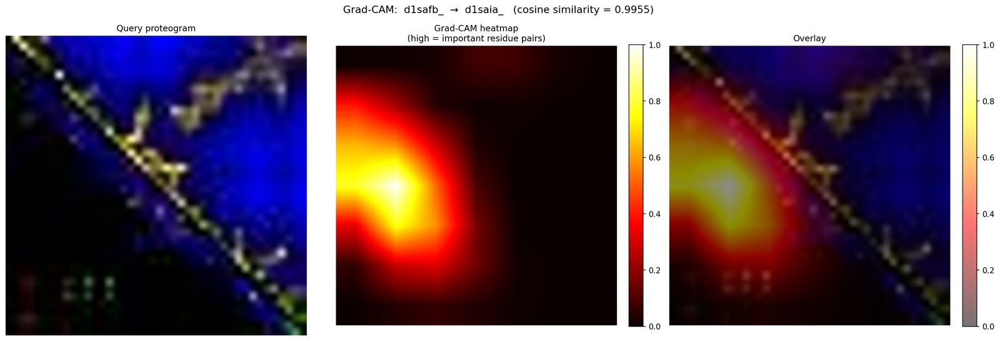
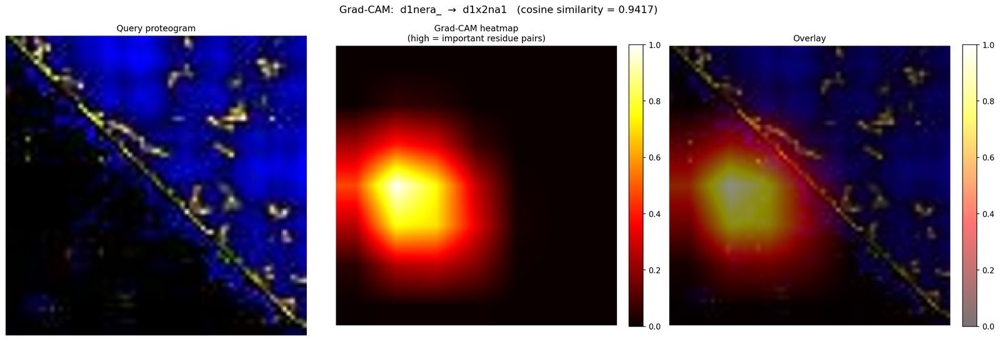
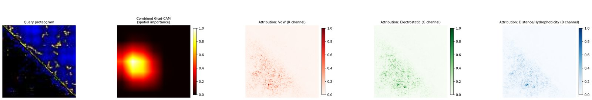
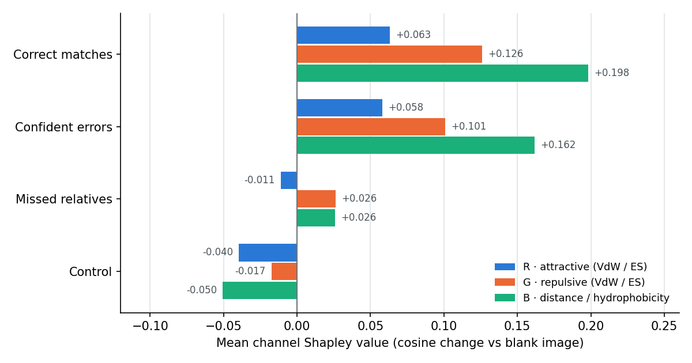
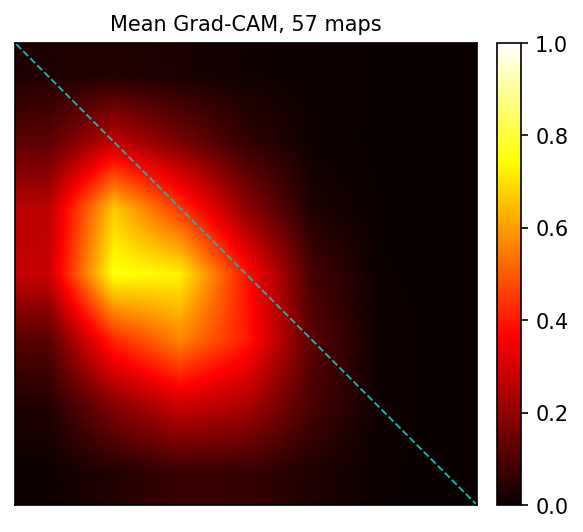
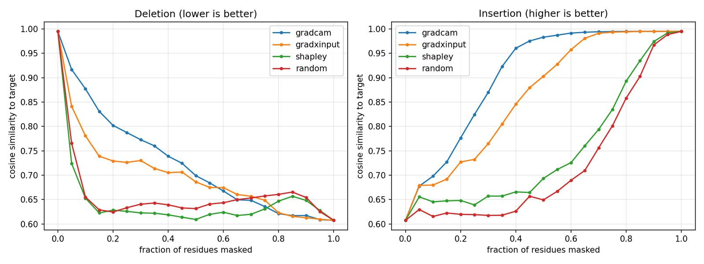
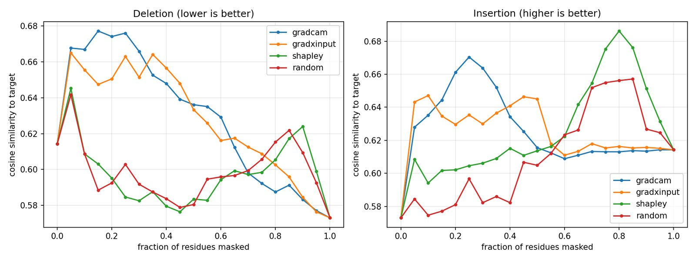

# Proteogram similarity attribution on `lj_fix` proteograms

Run date: 2026-11-08 · branch `pr2-attribution`

**Background.** A proteogram is an image of one protein domain. Pixel (i, j)
encodes the interaction between residues i and j: interaction energies,
Cα distance and hydrophobicity. Similarity search embeds each proteogram with
a ResNet18 and compares embeddings by cosine similarity, where 1.0 means
identical. Domains are labelled with SCOPe *sccs* codes,
class.fold.superfamily.family, e.g. `a.53.1.1`. The proteograms used here are
built from **coarse-grained** molecular-dynamics structures (`cg_method:
martini`, the repo's only coarse-grained option), not full-atom ones. The saved
production structures have one Cα bead per residue.

This report applies the branch's attribution tools (Grad-CAM, Grad × Input and
Shapley) to the superfamily ResNet18 on its held-out test set. It asks two
questions: which regions and channels make two proteograms look similar, and
do the attribution maps actually reflect what the model relies on?

## Key findings

| | Finding |
|---|---|
| **Channels** | Channel B (Cα distance / hydrophobicity) contributes most. Exact channel Shapley values give B about half of the explained similarity in high-similarity pairs. |
| **Grad-CAM location** | 82% of Grad-CAM mass and 55 of 57 peaks fall below the diagonal, the half holding electrostatics and hydrophobicity. Maps for different pairs correlate at 0.70, so one map says little about the specific pair. |
| **Faithfulness** | The gradient maps are *sufficient* but not *necessary*. Restoring their top regions rebuilds similarity fast (insertion AUC 0.91 vs 0.72 random). Deleting them hurts less than deleting random regions (0.72 vs 0.66, lower is better). |
| **Which method** | Channel Shapley for "which channel", Grad-CAM for "which region is enough", residue Shapley (with caution) for "which residues it depends on". See [Conclusion](#conclusion). |
| **Code issues** | Channel G is labelled "electrostatic" but is the repulsive channel. Residue masking ignores the 180° rotation of the lower triangle. See [Issues found](#issues-found-in-the-branch). |

## Setup

- **Model:** `proteogram_model_resnet18_lr0.001_bs8_e53_seed0_max_image_size300_input200_resize_min_class_size20_level-superfamily_lossce_acc93.9.pt`.
  This is the only model trained on coarse-grained proteograms. Its checkpoint
  metadata says `input_size: 200, resize: True`.
- **Proteograms:** `scripts/data/proteograms_v2_lj_fix` (coarse-grained, JPG).
- **Corpus:** the model's test list, 1,596 of 1,603 domains present in `lj_fix`.
- **Preprocessing:** images are resized to 200×200, as in training, for both
  search and attribution. Attribution cosine scores match the search scores
  exactly.
- **Hardware:** one RTX 4060 Ti. The full run takes about 30 minutes.

**Retrieval check.** The model behaves normally on `lj_fix`:

| Metric | Value |
|---|---|
| Top-1 hit in same superfamily | 94.6% |
| Top-1 hit in same fold | 96.1% |
| Superfamily match in top 5 | 96.9% |

**Pair groups.** USalign covers only 24 of these domains, so pairs are labelled
with SCOPe 2.08 superfamily and fold from `dir.cla`. There are 8 pairs per
group, and each domain appears at most once per group (list in
[`data/selected_pairs.tsv`](data/selected_pairs.tsv)):

| Group | Rule | Cosine range |
|---|---|---|
| Correct matches | top-1 hit in the same superfamily, highest cosine | 0.994–0.996 |
| Confident errors | top-1 hit in a different fold, highest cosine | 0.910–0.942 |
| Missed relatives | least similar same-superfamily partner | 0.561–0.647 |
| Control | least similar different-fold partner | 0.346–0.364 |

## How to read the outputs

A v2 proteogram packs two sets of residue-pair maps into one image
(`proteogram/v2/proteogram.py`):



So **R** is attractive energy, **G** is repulsive energy and **B** is
geometry/chemistry. Each channel mixes two quantities. A lower-triangle pixel
(i, j) belongs to residues (N−1−i, N−1−j).

- **Grad-CAM** is a heatmap image. It is the gradient of the cosine similarity
  at ResNet18's last conv block (7×7), upsampled to 200×200. Bright means "this
  region raised the similarity". It is coarse: one cell covers about 28 rows.
  The 3-panel figure shows query, heatmap and overlay.
- **Grad × Input** gives per-pixel, per-channel maps: the gradient times
  (pixel − 128), so empty regions score zero. The 5-panel figure shows query,
  Grad-CAM, then one map each for R, G and B.
- **Shapley** gives numbers, not images. Exact channel Shapley removes channel
  combinations (set to neutral 128) and re-scores the pair 8 times. The three
  values add up to cos(query, target) − cos(blank, target). A residue-level
  version is used only in the faithfulness test.

### Example: a correct match



`d1safb_ → d1saia_`, both a.53.1.1, cosine 0.9955. The heatmap peaks in the
lower-left, away from the diagonal contacts.

### Example: a confident error





`d1nera_` (a.35.1.2) → `d1x2na1` (a.4.1.1), cosine 0.94 across different folds.
Grad-CAM again sits in the lower-left. The per-channel Grad × Input maps
(panels 3–5) spread over the whole lower triangle.

> **Panel titles in this figure are the branch's old labels.** Read
> "VdW (R)" as *attractive*, "Electrostatic (G)" as *repulsive* and
> "Distance/Hydrophobicity (B)" as *distance (upper) / hydrophobicity (lower)*.
> See issue 2 below.

## Which channels drive similarity



These are exact channel Shapley values, averaged over the 8 pairs in each
group. The values add up exactly to the score gain over a blank image (largest
error 6×10⁻¹⁷).

| Group | φ R (attractive) | φ G (repulsive) | φ B (distance / hydro) | cos(query, target) | cos(blank, target) |
|---|---:|---:|---:|---:|---:|
| Correct matches | +0.063 | +0.126 | **+0.198** | 0.995 | 0.607 |
| Confident errors | +0.058 | +0.101 | **+0.162** | 0.928 | 0.607 |
| Missed relatives | −0.011 | +0.026 | +0.026 | 0.614 | 0.573 |
| Control | −0.040 | −0.017 | −0.050 | 0.358 | 0.465 |

- **High-similarity pairs:** channel B leads in both groups. Correct matches and
  confident errors have almost the same channel mix, so the mix doesn't explain
  why the model mistakes a different fold for a match.
- **Low-similarity pairs:** the explained amount is close to zero. For the
  control group a blank image (0.47) is more similar to the target than the
  real query (0.36), so every channel comes out negative.

> **Don't use the gradient-based channel summary.** The script's gradient
> "dominant channel" names G in all 32 pairs at 44–46%. Its energy/distance
> ratio is 3.67–3.75 in every group, controls included. A number that doesn't
> change between correct matches and random controls says nothing about the
> pair.

## Where Grad-CAM looks



| Statistic (57 maps: 32 selected pairs + 25 worst-retrieved queries) | Value |
|---|---|
| Heatmap mass below the diagonal | 82% (range 38–94%) |
| Peaks below the diagonal | 55 / 57 |
| Mean correlation between maps of different pairs | 0.70 |

The model's last-layer attention sits in the same lower-left block for almost
every pair. That block holds electrostatic and hydrophobicity values. Because
the lower triangle is rotated 180°, it describes pairs among the later residues
of the chain, not the early ones its position suggests.

## Are the maps faithful?

These are deletion and insertion curves (Petsiuk et al., RISE), at residue
granularity: row + column, masked to neutral 128. Each curve tracks cosine
similarity as more residues are masked or restored. **AUC** is the area under
that curve over the 0–1 x-axis (fraction of residues masked).
- **Deletion:** removing the top-ranked residues should drop similarity fast,
  so lower is better.
- **Insertion:** restoring them to a blank image should recover similarity fast,
  so higher is better.

| Group | Method | Deletion AUC ↓ | Insertion AUC ↑ | Gap | Deletion vs random | Insertion vs random |
|---|---|---:|---:|---:|---|---|
| Correct matches | Grad-CAM | 0.723 | **0.908** | 0.185 | worse | better |
| | Grad × Input | 0.697 | 0.867 | 0.170 | worse | better |
| | Residue Shapley | **0.642** | 0.750 | 0.108 | slightly better | slightly better |
| | Random | 0.657 | 0.721 | 0.063 | | |
| Confident errors | Grad-CAM | 0.711 | **0.848** | 0.137 | worse | better |
| | Grad × Input | 0.687 | 0.806 | 0.119 | worse | better |
| | Residue Shapley | **0.639** | 0.725 | 0.086 | about equal | slightly better |
| | Random | 0.645 | 0.702 | 0.057 | | |
| Missed relatives | Grad-CAM | 0.630 | 0.627 | −0.003 | worse | about equal |
| | Grad × Input | 0.628 | 0.626 | −0.002 | worse | about equal |
| | Residue Shapley | 0.598 | 0.626 | 0.028 | about equal | about equal |
| | Random | 0.599 | 0.610 | 0.011 | | |
| Control | Grad-CAM | 0.500 | 0.429 | −0.071 | about equal | worse |
| | Grad × Input | 0.506 | 0.459 | −0.047 | about equal | worse |
| | Residue Shapley | 0.500 | 0.506 | 0.005 | about equal | about equal |
| | Random | 0.501 | 0.488 | −0.013 | | |



*Correct matches.* Left: Grad-CAM (blue) keeps similarity high while its top
regions are removed, so it does worse than random (red) on deletion. Right:
Grad-CAM and Grad × Input restore similarity far faster than random.



*Missed relatives.* No method separates from random, as expected when there is
almost nothing to explain.

**Reading.** The regions Grad-CAM picks are enough on their own to rebuild the
similarity. The model does not depend on them, though: once they are removed,
other regions carry the same signal. Residue Shapley (3 sampled orders per
pair) is best on deletion but only slightly ahead of random. Present Grad-CAM
as "a region sufficient for this score", not "the residues that cause the
similarity".

## Conclusion

**Overall.** The superfamily model retrieves well on `lj_fix`: 94.6% top-1
superfamily. For high-similarity pairs, about 40% of the similarity is
explained by the image content, measured against a blank image. Channel B
(distance / hydrophobicity) carries the largest share, then the repulsive
channel, then the attractive one. The gradient methods mainly show *where* the
network looks, which is nearly the same lower-triangle block for every pair.
They do not show what the score depends on. None of the methods tells
correct matches apart from confident cross-fold errors, so these tools cannot
yet explain *why* the model makes those errors.

### Which method to use when

| Question you want answered | Best method here | Why | Cost per pair |
|---|---|---|---|
| Which channel (attractive / repulsive / distance-hydrophobicity) drives this similarity? | **Channel Shapley** | Exact, sums to the explained similarity, and differs between groups. The gradient channel summary was the same in every group. | 8 forward passes |
| Which region is *enough* to make the query look like the target? | **Grad-CAM** | Best insertion AUC in both high-similarity groups (0.91, 0.85 vs 0.72, 0.70 random) | 1 backward pass |
| Which region, at residue-pair resolution, for a figure? | **Grad × Input** | Per-pixel and per-channel, with insertion close to Grad-CAM (0.87 vs 0.91). Grad-CAM's 7×7 grid can't resolve residue pairs. | 1 backward pass |
| Which residues does the score *depend on*: remove them and similarity drops? | **Residue Shapley**, with caution | The only method at or below random on deletion. At 3 permutations the margin is small (0.642 vs 0.657). | 3 × (N+1) forward passes, about 600 at N=200 |
| Why does the model confuse two different folds? | None yet | Channel mix and Grad-CAM location look the same for correct matches and confident errors | — |
| Explaining a low-similarity pair | Don't | Similarity is at or below a blank image. No method beats random. | — |

### Practical rules

1. **Check how much there is to explain first.** If cos(query, target) −
   cos(blank, target) is near zero or negative, skip attribution. That was the
   case for missed relatives (+0.04) and controls (−0.11).
2. **Use Grad-CAM to make a figure, not to make a claim.** Its maps correlate
   at 0.70 across unrelated pairs, so describe it as "a region sufficient for
   this score", not "the residues that cause the similarity".
3. **Report channel Shapley, not the gradient energy/distance ratio.** The
   ratio stayed at 3.7 whether the pair was a true match or a random control.
4. **Before trusting residue-level results, fix the lower-triangle rotation**
   (issue 3 below) and raise `--shapley_permutations` until the method ranking
   stops changing.

### Next steps

- Fix the channel labels and the residue masking rotation (issues 2 and 3), then rerun.
- Use 30 or more pairs per group, ideally with TM-scores, so the group differences can be tested statistically.
- Compare confident errors against correct matches at residue level, once
  issue 3 is fixed, to look for what drives cross-fold confusion.

## Issues found in the branch

1. **Preprocessing ignored the checkpoint. Fixed in this branch.**
   `gradcam._pad_to_size` always padded or cropped to 200. Resize-mode models
   like this one were trained on resized images, so proteins longer than 200
   residues were cropped. The fix adds `configure_preprocessing_from_meta` and
   `load_model_input_array` in `proteogram/v2/gradcam.py`. They are used by
   `masking.py`, `image_similarity.py` and the three scripts. Figures now show
   the image the model saw, so heatmaps line up with it. The earlier results
   in [`../attribution/`](../attribution/) were produced before this fix.
2. **Channel labels are wrong for half the image. Not fixed.** Figures and
   stats call R "VdW", G "Electrostatic" and B "Distance". That is only true
   for the upper triangle: R is attractive, G is repulsive, B is distance or
   hydrophobicity. "Dominant = Electrostatic (G)" really means "the repulsive
   channel".
3. **Residue masking ignores the 180° rotation. Not fixed.**
   `masking.mask_residues` blanks row i and column i. In the lower triangle
   that removes residue N−1−i, not residue i. So residue Shapley and the
   residue faithfulness curves mix two residues per "player".
4. **Empty summary with `--pairs_file`. Not fixed.**
   `explain_energy_channels.py` prints its per-group summary only for `--auto`
   group names, so it is blank for user-supplied pairs. The combined CSVs here
   were written separately.

## Caveats

- 8 pairs per group, so treat the numbers as directional.
- The model was trained before `lj_fix` was generated (9 Aug vs 26–27 Aug
  2026). Retrieval quality suggests this matters little.
- Groups come from SCOPe labels and model cosine, not TM-score.
- With resizing, one grid row is about N/200 residues, not exactly one residue.
- Residue Shapley used 3 sampled orders per pair, which is noisy.

## Files

| Path | Contents |
|---|---|
| [`data/selected_pairs.tsv`](data/selected_pairs.tsv) | The 32 pairs, cosine and SCOPe sccs |
| [`data/channel_attribution_stats.csv`](data/channel_attribution_stats.csv) | One row per pair: gradient stats and channel Shapley values |
| [`data/faithfulness_summary.csv`](data/faithfulness_summary.csv) | One row per group × method |
| [`reproduce/`](reproduce/) | `config.example.yml` (copy to `config.yml`), `make_pairs.py`, `run_explain.sh` |
| `figures/` | Figures used above |

## Reproduce

Data lives in `scripts/data/`, which is git-ignored. You need these inputs:

| Input | Path under `scripts/data/` | Source |
|---|---|---|
| Model checkpoint | `proteogram_model_resnet18_…_acc93.9.pt` | *TODO: where to obtain* |
| Model test list | `test_list_for_model__resnet18_…_acc93.9.lst` | written by `train_multiple_models_randomized_eval.py` alongside the model |
| `lj_fix` proteograms | `proteograms_v2_lj_fix/` | *TODO: generation command and settings* (`create_v2_proteograms.py`, `cg_method: martini`) |
| SCOPe 2.08 classification | `dir.cla.scope.2.08-stable.txt` | [SCOPe 2.08 parseable files](https://scop.berkeley.edu/downloads/parse/dir.cla.scope.2.08-stable.txt) |

Then, from the repo root:

```bash
R=scripts/data/explainability_lj_fix
mkdir -p $R/corpus && cp docs/results/attribution_lj_fix/reproduce/* $R/
mv $R/config.example.yml $R/config.yml
# link the model's test-set proteograms from lj_fix
while read id; do
  f=$PWD/scripts/data/proteograms_v2_lj_fix/$id.jpg; [ -f "$f" ] && ln -sf "$f" $R/corpus/
done < scripts/data/test_list_for_model__resnet18_lr0.001_bs8_e53_seed0_max_image_size300_input200_resize_min_class_size20_level-superfamily_lossce_acc93.9.lst

cd $R
uv run --project ../../.. python ../../v2/measure_similarity_v2.py --overwrite
uv run --project ../../.. python make_pairs.py proteogram_sim_results.tsv ../dir.cla.scope.2.08-stable.txt . 8
./run_explain.sh > run_explain.log 2>&1
```
